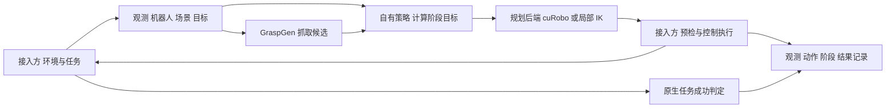

# 管线接入接口第一版

第三阶段交付的是数据和方法约定、可执行校验、LIBERO 源码映射及真实记录样例。现有驱动继续使用第二阶段实现，尚未切换为这些接口；没有新增通用运行适配器或其他 benchmark 的实现。

接入方需要提供本环境的任务语义、观测、机器人描述、碰撞场景、执行和原生成功判定。我们的现有策略负责阶段编排与目标位姿计算，GraspGen 负责抓取候选，cuRobo 和局部 IK 负责数值规划。

## 接口文件

| 内容 | 入口 |
| --- | --- |
| 字段和数组结构 | [pipeline-v1.schema.json](../../contracts/pipeline-v1.schema.json)，版本 `1.0` |
| Python 方法签名 | [ports.py](../../src/graspgen_libero_bridge/contracts/ports.py) |
| 数据约定和单位 | [DATA.md](DATA.md) |
| 方法职责、生命周期和错误处理 | [SERVICES.md](SERVICES.md) |
| 当前 LIBERO 如何对应、还缺什么 | [LIBERO_REFERENCE.md](LIBERO_REFERENCE.md) |
| 当前代码的能力要求 | [libero_v10_teacher.json](../../contracts/profiles/libero_v10_teacher.json) |
| 真实记录转换的样例 | [libero_v10_reference.json](../../contracts/examples/libero_v10_reference.json) |

Schema 定义 14 类数据包：`Observation`、`RobotSpec`、`TaskSpec`、`SceneSnapshot`、`Capabilities`、`PlanRequest`、`PlanResult`、`ExecuteRequest`、`ExecutionReport`、`PreviewResult`、`ReadinessReport`、`TaskOutcome`、`TrajectoryRecord`、`ReferenceBundle`。

Python Protocol 只约定方法，不提供实现。数据包采用 JSON 可表达的对象，具体必填字段以 Schema 为准；其他语言的适配方也可按同一约定实现。

## 边界关系



图表示接入边界，不表示现有驱动已经通过 Protocol 调用这些组件。完整实施步骤、文件改动和 benchmark 差异见第四阶段的[外部接入指南](../integration/README.md)。

## 如何校验

在具备 `jsonschema` 的开发解释器中，从代码根目录运行：

```bash
python tools/check_contracts.py --report migration/CONTRACT_VALIDATION.json
PYTHONPATH=src python -m pytest -q tests/test_contracts.py
```

校验只读历史样例，不启动环境、模型或 GPU。可选依赖列在 [requirements-check.txt](../../contracts/requirements-check.txt)，不需要装进现有三个 actor 环境。

字段通过校验只说明数据结构和部分语义一致。`readiness` 还会检查声明的能力、缺失数据和版本对应；它不搜索路径，也不能证明物体能抓稳或任务会成功。

本轮验收：113 项 CPU 测试全部通过，无跳过；1040 组原有效配置无差异。第二阶段 71 个已验证文件保持不变，本轮 85 个代码、配置和参考文件与服务器实测副本哈希一致。记录见 [VALIDATION.json](../../migration/phase3/VALIDATION.json)和[CONTRACT_VALIDATION.json](../../migration/phase3/CONTRACT_VALIDATION.json)。

## 兼容与版本

当前支持约束由 profile 表达：robosuite Panda、Panda 夹爪、七关节、原有 teacher 输入。Schema 的可变长度关节数组不等于当前规划器已支持其他机器人。更换夹爪、双臂、移动底盘或引擎，需要相应模型和后端，不能靠补字段完成。

版本字段必须显式携带；未知必填字段或版本应报兼容错误。扩展时保留原始任务、原始结果和数据来源。标准视觉输入与 teacher 输入分别记录，不能把仿真真值隐藏成相机观测。
