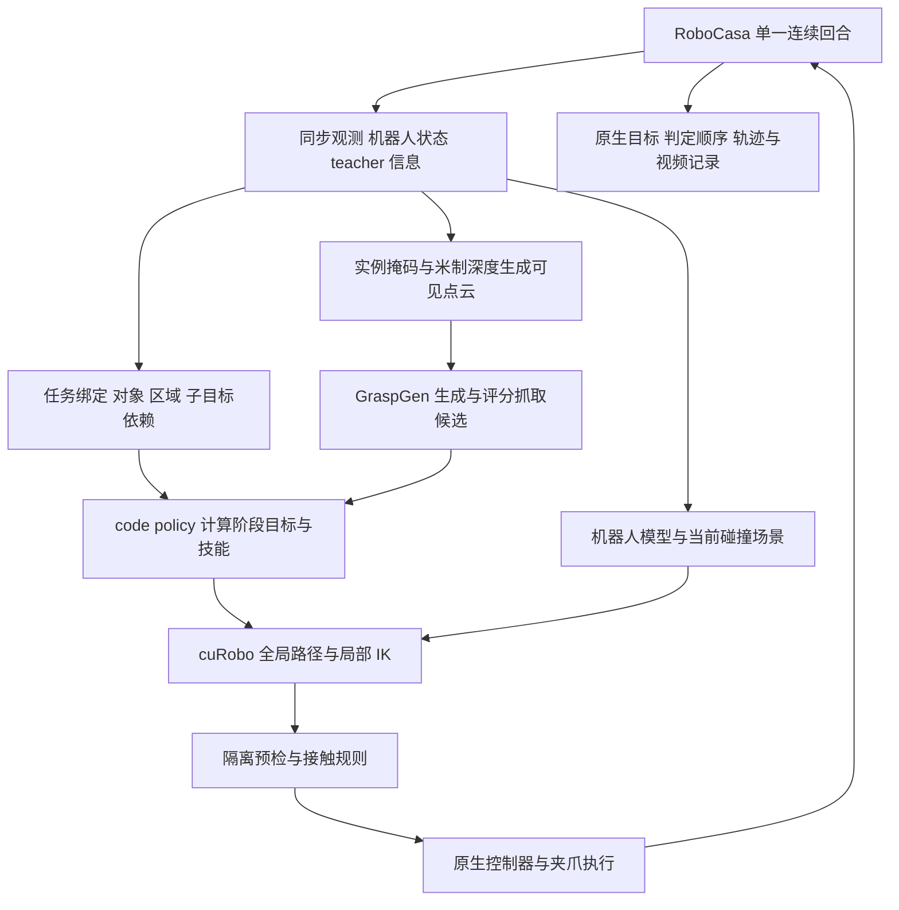

# RoboCasa 接入规划与有效性实验

本计划把现有 GraspGen、code policy、cuRobo 与 MuJoCo 控制链迁移到 RoboCasa，验证它能否持续产生完整、可审核的成功轨迹，并为后续 VLM 训练保存观测、技能选择和关键位姿。实施顺序是环境与控制验收、抓放迁移、机构操作、移动与复合任务，最后冻结版本做统一测试。

日期：2026 年 11 月 12 日。开发分支为 `RoboCasa`，起点为 `298ce25d9e0e2a606e63f39bedc58eadcea5fab3`；`libero` 分支和冻结 v10 基线保留。本文件记录预先制定的实施与实验设计；后续代码及实测进度见[接入状态](IMPLEMENTATION_STATUS.md)，不将计划值视为实测结果。

配套的[实验设计单](EXPERIMENT_PROTOCOL.json)现由批量脚本读取任务矩阵和种子范围；预算与策略值以每回合保存的有效配置为准。已有[文件改动清单](../integration/FILE_CHANGES.md)、[九类接口](../interfaces/SERVICES.md)和[G0 至 G8 验收](../integration/DEBUG_VALIDATE.md)继续适用。

## 目标与结论边界

| 要回答的问题 | 实验证据 |
| --- | --- |
| 原抓放链能否迁移 | 在新环境完成接近、闭合、保持抬升、搬运、释放和原生任务判定；单独记录只适配环境时的结果 |
| 能否扩展到抓放之外 | 对抽屉、柜门、旋钮和底盘逐个验收，再在同一回合执行复合任务 |
| 是否依赖逐任务调轨迹 | 区分开发任务和未用于调参任务；冻结共享策略、参数和任务绑定后统一运行新初态 |
| GraspGen 和规划器是否有实际帮助 | 在相同初态、观测和预算下，分别替换抓取候选排序、候选生成和全局规划 |
| 成功轨迹是否适合制作训练数据 | 原生目标、操作顺序、持物与放置稳定性、观测和决策时间对齐均通过审核 |

第一阶段采用 **RGB-D 可见点云＋仿真实例掩码＋显式 teacher 信息**。任务对象、目标区域、物体与机构状态、碰撞几何允许由仿真读取，并逐项记录来源。GraspGen 接收目标的部分点云，RGB 用于记录与后续训练；不把物体完整几何偷偷补进抓取输入。

这能验证仿真 teacher 管线及代码策略的迁移能力；仅 RGB 感知、真机部署和 VLM 自主决策另设实验。纯柜门、旋钮和导航任务不要求调用 GraspGen，其成功也不作为 GraspGen 抓取能力的证据。

## 环境与版本选择

优先直接接入官方 RoboCasa365，机器人采用原生 `PandaOmron`，不引入 RPent 的 RLDX 动作模型。现有 RPent 只作为控制、相机和结果接口的参考，避免把其他策略的成功混入本管线。

本次查阅的官方源码为 `3443cdf3dd20f9ae8ed41adba442059b506891d0`。实施时优先尝试该版本，记录实际安装与兼容性结果；robosuite、MuJoCo、CUDA、资产和规划依赖在 M0 固定实际版本。官方安装说明当前要求 robosuite master，因此必须记录测试通过的具体 commit，不能沿用 LIBERO 的 robosuite 1.4.1 环境混装。[官方安装说明](https://github.com/robocasa/robocasa/blob/3443cdf3dd20f9ae8ed41adba442059b506891d0/README.md)

官方创建入口使用 `robocasa/<任务类名>`，支持 `pretrain` 和 `target` 场景/物体 split。所查版本默认机器人是 PandaOmron，深度需要显式启用。M0 先核对实际输出，再决定使用原生创建函数还是 Gym 包装；不照搬旧版 `PnPCounterToCab` 等名字。[环境创建源码](https://github.com/robocasa/robocasa/blob/3443cdf3dd20f9ae8ed41adba442059b506891d0/robocasa/utils/env_utils.py)

仿真单独建立 RoboCasa Python 环境；GraspGen 和 cuRobo 继续用隔离 worker。首先核对实际 Panda 夹爪几何、指关节和 TCP，再决定是否复用现有 Panda 权重及机器人模型。模型名称相同不能替代标定。

## 需要接通的运行链

### 任务绑定与策略

RoboCasa 不使用 LIBERO 的 BDDL 查询结构。新增任务绑定，将原生任务中的对象、fixture、目标区域、机构属性、子目标依赖和原生成功函数映射为 `TaskSpec`。先为选中的任务明确绑定；不承诺自动理解全部任务的自然语言。

任务相关信息允许包括“取哪个对象”“送到哪个区域”“先开柜门再放入”等语义约束。共享技能根据运行时几何计算接近、抬升、搬运与放置位姿。禁止按任务名或 seed 保存固定世界坐标、成功关节轨迹、特制终点或失败任务专属容差。新增绑定和参数均进入改动清单，记录它们影响哪些任务。

现有 Protocol 尚未接入运行链。新 driver 必须实际通过提供方查询状态、规划、预检和执行；只新增空接口类不能进入任务实验。机构或移动数据若超出现有 Schema，新增明确的兼容版本和校验，保留旧 LIBERO profile。

### 机器人与控制

- 从实际 composite controller 读取机械臂、夹爪、躯干、底盘和模式的动作切片、边界、参考系、delta/absolute 语义及控制频率。官方包装呈现 12 个连续动作量；执行器以实际配置为准，完整保留末端位置与旋转。[官方包装源码](https://github.com/robocasa/robocasa/blob/3443cdf3dd20f9ae8ed41adba442059b506891d0/robocasa/wrappers/gym_wrapper.py)
- 先保持底盘和躯干在原初态，验收局部单臂抓放；模型要包含该状态下的基座、躯干及碰撞体。此阶段仅声明局部操作能力，移动需求失败保留在总体分母中。
- 后续增加底盘避障、速度控制与停止后重新标定。导航由独立移动技能负责，cuRobo 先负责机械臂路径；记录实际后端，不把底盘运动称为七关节 cuRobo 规划。
- 躯干先采用明确的有限高度候选，移动后更新 `world_T_arm_base`、机器人碰撞体、相机与场景版本。第一版不实现同时移动底盘、躯干与机械臂的联合优化。
- `world_T_tcp = world_T_grasp @ grasp_T_tcp` 的偏移必须实测；抓起后更新 `tcp_T_object`，由期望物体位姿反算 TCP 目标，避免把物体中心直接当末端目标。

### 场景与接触

场景导出包含台面、墙、柜体、门板、抽屉、把手、其他物体和持物附件，核对 mesh 缩放与开口。篮子、柜体等凹结构不能被一个填实的包围盒封住内部；简化几何需要叠加图和误差记录。

抓取、搬运、放置和机构操作分别定义允许的接触：手指可以触碰目标/把手，释放阶段可以建立目标支撑接触；其他障碍仍需检查。机构移动后更新门板和抽屉几何。预检优先用隔离模型；若保存恢复真实仿真，需恢复物理状态、时间、控制器内部目标、任务内部状态及随机状态，证明其不改变实际回合。

局部 IK、接触监测与预检作为明确后端保留。每条路径记录是 cuRobo、局部 IK 还是回退生成，不能只因安装了 cuRobo 就把全部路径归给它。

## 实施阶段和交付物

| 阶段 | 工作与验收 | 后续脚本与产物 |
| --- | --- | --- |
| M0 环境和清单 | 原生环境能创建、reset、观测和关闭；固定版本、机器人、相机、seed 与 horizon；核对 12 个任务和能力缺口 | 环境探针；`ENVIRONMENT_LOCK.json`、`TASK_INVENTORY.json`、初态快照和多视角图 |
| M1 提供方与控制 | 接通九类接口和独立 driver；通过数据、FK、相机、动作、限位、夹爪保持、预检恢复验收 | 坐标/模型诊断、空载移动脚本；误差表、叠加图、诊断视频 |
| M2 抓放迁移 | 先保留可复用的 v10 抓放规则；再加入必要的通用几何适配，分开记录两个版本；完成接近至释放的连续任务 | 单任务运行脚本；抓取候选、阶段目标、真实执行轨迹和结果 |
| M3 机构技能 | 平移抽屉沿关节轴运动；柜门/旋钮沿关节轴和锚点分段运动；检测滑脱、卡住和反向运动 | 抽屉、门和旋钮诊断脚本；关节进度与接触记录 |
| M4 移动与复合 | 底盘/躯干调整、停止与重建场景；同一环境连续完成多个子目标；验证顺序和最终释放 | 移动技能、子目标调度和复合任务脚本；全程视频与依赖图 |
| M5 冻结实验 | 固定代码、参数、任务绑定、观测模式、预算和完整任务矩阵，完成主实验及对照 | 批量队列、失败诊断、报告与关键点导出脚本 |

M0、M1 先通过再判断模型效果。首个完整抓放演示优先选择开发任务 `PickPlaceCounterToStove`；如果该固定初态需要移动，先记录能力缺口，另用同任务的开发初态做局部诊断，原失败记录保留。

柜门操作需要的是“接触把手并沿机构轨迹持续运动”，不能仅给最终开门点。cuRobo 负责可达的接近/撤离等自由运动；受约束段由机构技能生成分段目标、局部求解与闭环控制完成。擦洗、倾倒、工具使用和复杂持续接触在后续扩展阶段逐类实现。

### M1 的建议工程阈值

以下是初始验收门槛，需在开发场景确认后冻结，属于本计划的工程参数：

| 检查 | 门槛 |
| --- | --- |
| 规划 FK 与仿真 TCP | 至少 20 个有效关节姿态，最大位置误差 ≤2 mm，旋转误差 ≤1° |
| 空载闭环执行 | 至少 10 个可达位姿，位置 ≤10 mm、旋转 ≤5°；在原生步数预算内收敛 |
| 深度与像素 | RGB/深度/掩码同步、相同方向；目标投影和已知几何无系统偏移，报告实际残差 |
| 预检恢复 | 离散状态和计数完全恢复，连续状态误差 ≤1e-9；无真实动作记录被预检污染 |
| 动作和终止 | 每个动作分量有独立正负方向验证；达到原生步数限制或外层超时后不再执行动作 |

未通过先修模型、单位、坐标或控制映射。抬升高度、接近距离、搬运余量和放置高度从实际几何生成有限候选；候选范围、容差和预算统一配置。原 v10 的 0.097 m 偏移、0.15 m 抬升不能直接当成新机器人的标定结果。

## 代码修改与脚本顺序

以下均为拟新增路径，相对 `grasp-pipeline/`；目前尚无这些可执行入口。

| 路径 | 职责 |
| --- | --- |
| `src/graspgen_libero_bridge/adapters/robocasa/` | 环境生命周期、任务绑定、机器人、相机、区域、场景和原生结果提供方 |
| `src/graspgen_libero_bridge/control/robocasa_executor.py` | 完整动作映射、末端跟踪、夹爪保持、机构控制、真实动作计数 |
| `src/graspgen_libero_bridge/planning/robocasa_robot.py` | PandaOmron 实际模型、基座/躯干状态、TCP、碰撞与 FK 核对 |
| `src/graspgen_libero_bridge/policy/robocasa_skills.py` | 通过提供方调用抓放、机构、移动技能，采用最新观测生成阶段目标 |
| `apps/robocasa/run_task.py` | 同一回合内的依赖调度、能力检查、worker 生命周期、终止和最终记录 |
| `configs/robocasa/` | 独立任务绑定、机器人与技能参数、路径样例；真实机器路径用 `.local.json` |
| `contracts/profiles/robocasa_teacher.json` | 本环境真实能力要求及来源；不复用固定的 LIBERO readiness profile |
| `tools/robocasa/probe_env.py` | M0 的版本、任务、观测、动作和原生 horizon 探针 |
| `tools/robocasa/check_geometry_control.py` | M1 的坐标、碰撞叠加、空载执行和恢复核验 |
| `tools/robocasa/run_matrix.py` | 冻结任务矩阵、独立输出目录、资源调度和完整失败记录 |
| `tools/robocasa/diagnose_case.py` | 从保存状态进行终点/碰撞/执行诊断，输出独立诊断记录 |
| `tools/robocasa/build_report.py` | 按任务、技能、输入和版本汇总，生成包含全部视频的离线 HTML |
| `tools/robocasa/export_keypoints.py` | 提取决策前观测、技能调用、关键位姿和训练候选过滤结果 |
| `tests/robocasa/` | 对实际控制语义、场景更新、原生结果、连续回合和恢复边界做必要测试 |

优先新增独立 driver 和提供方，保留旧 LIBERO 入口。复用纯计算函数、GraspGen worker 和公共 RPC；拆分 `PickPlace` 的环境硬依赖、固定 Panda planner 构造、控制器私有字段和任务调度耦合。具体位置见[现有改动定位](../integration/FILE_CHANGES.md)。不要直接 import 会解析参数并启动任务的旧 driver。

若共享代码必须变化，建立独立适配版本和改动映射；冻结参考不改，原 `verify_preservation.py` 的检查不放宽。规划阶段所有原代码保持不变，实际实现时再定义适配版本的保持检查和 LIBERO 回归范围。

## 任务矩阵与开发边界

先固定下面 12 个代表任务，覆盖六类操作。任务类名与 `pretrain`、`target` 可用性已按所查官方[任务注册表](https://github.com/robocasa/robocasa/blob/3443cdf3dd20f9ae8ed41adba442059b506891d0/robocasa/utils/dataset_registry.py)核对；具体 reset、场景资产与成功条件由 M0/M2 再验收。

| 类型 | 任务 | 用途 |
| --- | --- | --- |
| 开放区域抓放 | `PickPlaceCounterToStove` | 开发 |
| 开放区域抓放 | `PickPlaceSinkToCounter` | 开发 |
| 柜内取放 | `PickPlaceCounterToCabinet` | 不用于调参 |
| 柜内取放 | `PickPlaceDrawerToCounter` | 不用于调参 |
| 抽屉和柜门 | `OpenDrawer` | 开发 |
| 抽屉和柜门 | `OpenCabinet` | 开发 |
| 旋钮操作 | `TurnOnSinkFaucet` | 开发 |
| 旋钮操作 | `TurnOffStove` | 不用于调参 |
| 移动 | `NavigateKitchen` | 开发 |
| 复合操作 | `StackBowlsCabinet` | 开发 |
| 复合操作 | `SetUpCuttingStation` | 不用于调参 |
| 复合操作 | `ArrangeBreadBasket` | 不用于调参 |

7 个开发任务允许使用 `pretrain` 的 seed 0–4 调试，所有尝试留存。其余 5 个任务可以在冻结前编写声明式任务绑定、核对语义，不使用轨迹成绩调整参数。因此报告称“未用于调参任务”，不把它夸大为完全未知任务的语言理解。

正式实验使用 12 个任务、`target` split、seed 100–119，共 **240 个回合**。7 个开发任务的 target 结果与 5 个未用于调参任务分别汇总。只改 seed 不保证独立厨房；记录实际 layout、style、对象实例和初态指纹，明确重复情况。

不得按是否可达、是否可见或首次成功筛选正式初态。移动暂未实现、任务绑定缺失和环境异常均留在 240 个计划回合的覆盖统计里。若调试时看过正式初态，标记污染；修改策略后换新实验版本并完整复测，不与历史最好结果拼接。

## 有效性实验

### E1 开发验收与迁移起点

M0/M1 使用数据与控制诊断，不以成功率评价模型。M2 在两个开发抓放任务的 5 个 pretrain 初态上，先记录“只适配环境、保留可复用 v10 规则”的版本，共 10 个回合。必要的策略扩展另建版本，形成可解释的改动前后对比。

完整开发版本再对 7 个开发任务各跑 5 个初态，共 35 个回合。初步工程目标是两个开发抓放任务各至少 3/5 完整成功，且整体开发集每个已实现技能都有真实执行证据；未达到时分析原因并继续开发，不能靠降低标准进入正式测试。

### E2 冻结版本主实验

固定同一代码、依赖、任务绑定、teacher 输入、参数、预算和模型权重，运行 12×20 回合。每个回合只有一次正式尝试；有限次重抓/重规划属于同一回合的全局统一策略，动作和耗时全部计入。外部重启另记 attempt，不能把多次运行后的最好结果当单次成绩。

按任务和六类技能报告：原生最终成功率、完整管线成功率、候选训练轨迹产出率，以及每任务是否至少产出一条合格轨迹。初步扩展目标为冻结主实验中至少 8/12 个任务各产出两条不同初态的候选轨迹；这是工程目标，不是预期或已取得的结果。

### E3 配对组件对照

主实验之后优先选三个抓放任务：`PickPlaceCounterToStove`、`PickPlaceSinkToCounter`、`PickPlaceCounterToCabinet`，使用同一批 target 初态 seed 100–109。完整管线的 30 条结果可复用 E2，不重新挑选场景。

| 组别 | 唯一主要改动 | 回答的问题 |
| --- | --- | --- |
| A 完整管线 | GraspGen 生成与评分、cuRobo 全局路径、相同局部控制 | 对照基准，复用 E2 的 30 回合 |
| B 不用判别器排序 | 复用 A 的同一批原始候选，按固定随机种子排序，其余检查、候选上限与重试不变 | 评分排序是否提高真实抓取与完整成功率 |
| C 几何抓取候选 | 同一份部分点云产生固定规则/PCA 抓取候选，后续使用相同规划与控制 | GraspGen 候选相对这套几何基线的增益 |
| D 替换全局规划 | 保留 GraspGen，改用笛卡尔插值＋局部 IK，保留相同碰撞检查 | cuRobo 全局规划相对局部方法的增益 |

B/C/D 各 30 回合，共新增 90 回合。A/B 在第一次分歧之前共享输入和候选；分歧后的真实状态变化不强行对齐。所有组从相同的规范初态重新创建回合，采用相同的计划次数、候选评估上限、物理重试、horizon 和总预算。几何基线不得读取 A 没有使用的完整物体几何；不通过关闭碰撞检查构造“更容易成功”的对照。

分别报告候选通过率、真正执行闭合后的持物成功、保持抬升、搬运/放置、完整任务和耗时。A/B 支持对本实现中评分排序价值的判断；A/C 支持与特定几何基线的比较，不能替代原论文的全部生成器实验。仅三个任务的对照用于趋势判断，差异小或方差大时再预注册扩大样本。

### E4 点云输入诊断

可选实验在两个开发抓放任务各 10 个新的 pretrain 初态上，对比单视角部分点云、多视角融合可见点云与完整几何 oracle。场景、权重、点数和预算一致，报告可见表面、点数、抓取与完整成功；完整几何只作诊断，不混入 RGB-D 主实验。

### E5 扩大任务覆盖

代表任务验证后，从所固定版本的官方任务目录生成完整能力清单，按抓放、机构、按钮/旋钮、导航、持续接触、工具与多阶段依赖分类。每类记录 supported、unsupported 和原因，再分批扩大，最终冻结另一版代码统一跑所选全集。首轮 12 个任务的比例不代表全部 RoboCasa 任务覆盖率。

官方通用评估通常按每任务 50 个场景报告原生二值成功信号；本计划每任务 20 回合用于工程验证，并单列 privileged teacher 条件，不能直接作为标准视觉策略榜单成绩。[官方评估说明](https://robocasa.ai/docs/build/html/benchmarking/benchmarking_overview.html)

## 终止与失败判定

所查官方环境创建使用 `ignore_done=True`；Gym 包装的 `truncated` 固定为 false。因此 runner 需要从固定版本任务注册表读取 horizon，自行累计真实环境动作步数并实施截断，保留包装层的原始 done/terminated/truncated。不能只等待 done，也不能擅自加倍任务步数。[环境源码](https://github.com/robocasa/robocasa/blob/3443cdf3dd20f9ae8ed41adba442059b506891d0/robocasa/utils/env_utils.py)、[包装源码](https://github.com/robocasa/robocasa/blob/3443cdf3dd20f9ae8ed41adba442059b506891d0/robocasa/wrappers/gym_wrapper.py)

首版墙钟预算建议：原子任务 900 秒、复合任务 1800 秒，包含该 worker 分配给本回合的初始化、模型加载、规划、执行和记录；队列等待单列。先用开发试跑核对可行性，M5 前统一冻结。阶段预算是总预算的子预算，不能每次重试重新获得整回合时长。原生 horizon、阶段预算和墙钟超时分别记录。

| 类别 | 直白含义与定位证据 |
| --- | --- |
| `ENVIRONMENT_ERROR` / `MODEL_ERROR` | 环境、资产、EGL、进程或权重加载未正常工作；不能算抓取模型失败 |
| `UNSUPPORTED_TASK_BINDING` / `UNSUPPORTED_SKILL` | 对象/目标未绑定，或所需技能尚未实现；写明缺少哪一步 |
| `OBSERVATION_INVALID` / `TARGET_NOT_VISIBLE` | 深度、掩码或标定不可用，或相机看不到目标；不偷偷改用完整几何 |
| `ROBOT_MODEL_MISMATCH` / `START_INVALID` | 机器人/TCP/关节映射不一致，或规划起点已处于冲突状态 |
| `GOAL_UNREACHABLE` / `COLLISION_REJECTED` | 在已核验模型下目标不满足可达/碰撞约束；保留失败状态、目标和几何叠加 |
| `SEARCH_BUDGET_EXHAUSTED` | 有限时间或候选内没找到路径；不等于数学上无路径 |
| `EXECUTION_TIMEOUT` / `TRACKING_ERROR` | 路径已生成，实际机械臂未按要求到位或进展停滞 |
| `GRASP_CONTACT_FAILED` / `HOLD_FAILED` | 完成了真实接近和闭合，但未接触/未抓牢，或抬升后滑落 |
| `ARTICULATION_STALLED` / `NAVIGATION_FAILED` | 把手持续接触或机构进度失败；底盘路径/跟踪失败另记子原因 |
| `PLACEMENT_UNSTABLE` / `NATIVE_GOAL_FALSE` / `ORDER_VIOLATION` | 放后不稳、最终原生目标未满足，或终态对但操作顺序不对 |
| `STEP_LIMIT` / `WALL_TIMEOUT` | 达到原生动作步数或外层时间预算；保留终止前阶段与状态 |

失败保存原始后端状态和阶段。对有疑问的路径失败，从同一保存状态改变终点朝向/高度/区域采样、比较精细与简化碰撞模型、再检查执行跟踪。诊断分支的动作不接回正式回合，不修改正式结果；代码修复后重新冻结并完整复测。

## 结果与训练数据

每个计划回合保存身份与版本、完整有效配置、任务原定义、编译后的场景 XML 与资产指纹、布局/物体/seed、初始物理/任务/控制器状态和 RNG、逐步观测和动作、机器人状态、阶段决策、计划及实际后端、接触与机构进度、最后状态、结果和视频。无法完整序列化的状态需要给出已验证的重建和重放方式。worker 常驻时记录其版本和冷/热状态，防止单任务与批量计时混淆。

成功指标分开计算：

- `native_success_at_end`：最后实际状态的原生判定；另存 `native_success_at_reset` 和 `native_success_seen`。
- `pipeline_success`：实际执行了任务动作、所需阶段完成、原生最终成功且满足指令顺序；初始化即成功不算新造出的轨迹。
- `training_candidate`：在完整成功基础上，通过稳定性、接触、时间对齐和观测可用性审核。它仍需最终训练样本质检。

主表分母固定为计划的 240 回合。unsupported、初始化失败、缺视频等均显式列出，另报有效执行回合中的条件成功率。保留所有失败视频；初始化前错误无法生成有效视频时记 `video_available=false` 和原因，不伪造静态视频充数。按任务给出成功次数、分母和 95% Wilson 区间，避免只展示最好演示。

每个决策点保存调用前的观测/历史引用、任务指令、`tool_name`、参数、目标实体、世界及相机坐标的位姿、`grasp_T_tcp`、预期子目标和调用后结果。抓放至少提取 pregrasp、grasp、lift、preplace、release、retreat；开门保存机构运动分段目标，导航保存基座目标和参考系。标签来源标为 `code_policy_teacher`，不能冒称 VLM 作出的工具选择。

输入训练集的观测不包含未来帧、最终成功标记或特权状态。如果目标在当前图像外，使用学生实际可获得的多视角/历史或重观测技能；缺少可观测依据的标签留作 teacher 诊断，不直接制作“单张 RGB 能推断”的 SFT 样本。官方也提供从仿真状态生成复合任务子任务标注的方法，可作为阶段命名和离线审核参考。[官方子任务标注](https://robocasa.ai/docs/build/html/use_cases/subtask_annotations.html)

时间分别记录初始化、模型冷启动、点云处理、GraspGen 推理、候选检查、cuRobo、局部 IK、仿真 step、渲染编码与排队，报告中位数/P90和峰值显存。GPU 操作计时需同步或用 CUDA event；重叠区间不直接相加，另报实际端到端墙钟。

交付 HTML 包含完整任务矩阵、每次成功/失败视频、原因、迭代版本和输入来源；提供嵌入视频或带相对路径的完整归档，离线打开验证。视频和原始轨迹放独立产物目录，不提交源码 Git。

## 资源与下一步

本轮规划不使用实验 GPU。实施时从一张空闲 GPU、一个“仿真＋GraspGen＋cuRobo”会话开始，量测显存、CPU、EGL 和吞吐；再决定单卡多会话数。每个会话独占环境和可变 worker 状态，候选缓存必须绑定回合、目标及输入指纹。并行度进入记录，正式版本不在运行途中调参。

下一步先实现 `probe_env.py`，固定环境和任务清单；随后实现提供方、机器人/控制探针和独立单任务 driver，通过 M1 后跑首个抓放。先交付一条完整成功和一条可解释失败，再扩展机构、移动与复合操作，最后执行冻结主实验。
