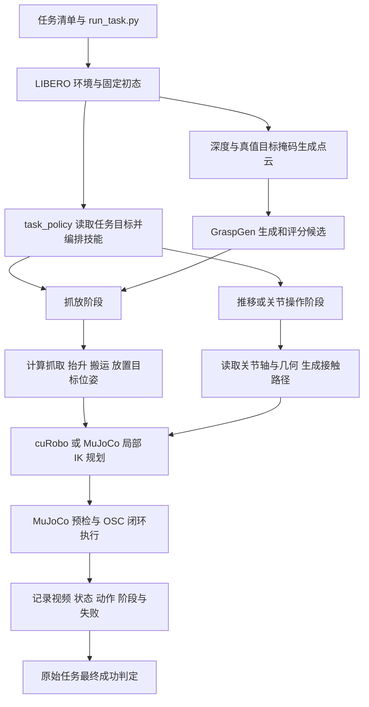

# 代码和数据流程

本文件描述冻结 v10 的原目录与执行逻辑。第二阶段整理后的目录和入口见 [新版组件结构](../../grasp-pipeline/docs/LAYOUT.md)，算法沿用本文件对应基线。

## 实际入口

最终 130 任务使用 [run_task.py](../baseline/v10/run_task.py)，从相邻 `ALL_TASKS.json` 读取任务配置，再覆盖本次测试参数。它创建一个环境回合，读取原始目标并生成阶段计划；各阶段在同一物理状态上连续执行，最后调用原始任务成功判定。

`bridge/run.sh` 和 `python -m graspgen_libero_bridge` 是原有独立抓放及诊断入口。只运行它们的默认单任务配置，不能复现最终 130 任务的调度逻辑与参数。

## 调用关系

code policy 决定每阶段做什么和目标位姿；GraspGen 输出抓取候选；cuRobo 接收数值目标、当前状态和碰撞场景。cuRobo 不读取任务语言来选择下一步，也不承担夹持是否稳定的全部判断。

## 39 个 Python 文件的职责

下列路径除驱动外均相对 `baseline/v10/bridge/graspgen_libero_bridge/`，描述冻结参考目录；整理后的工作副本已按新版结构分组。

| 分组 | 数量 | 文件与职责 |
| --- | --- | --- |
| 入口 | 3 | `run_task.py` 为完整任务驱动；`__init__.py`、`__main__.py` 为包入口 |
| 策略与技能 | 7 | `task_policy.py` 编排目标；`evaluate.py` 抓放主流程；`skills.py` 接触技能；`articulation.py` 关节几何和操作候选；`placement.py` 放置候选；`transfer.py` 搬运目标；`surface_packing.py` 多物体表面布局 |
| 点云与模型候选 | 4 | `pointcloud.py` 反投影和几何采样；`graspgen_worker.py` 模型推理；`grasp_candidate.py` 候选几何筛选；`grasp_contact.py` 夹持接触预演 |
| 规划与控制 | 4 | `planner_worker.py` cuRobo 服务；`planning_geometry.py` Panda 模型与碰撞表示；`cartesian.py` MuJoCo 局部 IK；`controller.py` OSC 跟踪、接触监测和记录 |
| 环境与场景几何 | 4 | `env_adapter.py` 环境和状态；`scene.py` 碰撞场景导出；`regions.py` 任务目标区域；`placement_geometry.py` 放置几何查询 |
| 通用辅助 | 3 | `frames.py` 位姿转换；`rpc.py` 本机进程通信；`errors.py` 失败记录 |
| 测试 | 14 | `bridge/tests/test_*.py`，保留原测试，不把文件数量当作测试用例数量 |

逐文件哈希、行数、导入、配置读取和耦合位置见 [SOURCE_INVENTORY.json](../audit/SOURCE_INVENTORY.json)。

## 观测如何进入模型

1. `env_adapter.py` 创建单 Panda 的 `SegmentationRenderEnv`，得到 RGB、深度、仿真实例分割和机器人状态。
2. `pointcloud.py` 根据已知目标实例的掩码，从 `agentview` 深度反投影出可见表面点，并变换到世界坐标。
3. `graspgen_worker.py` 采样为 2048 个 XYZ 点，中心化后交给官方 Panda 预训练生成器和判别器，返回恢复到世界坐标的抓取位姿与分数。模型不使用 RGB 特征，也没有在这里训练。
4. 策略转换 GraspGen 夹爪参考点为实际控制 site，筛选可达和接触条件，再规划执行。

`rgbd` 描述的是抓取输入点云来源。目标身份、分割、放置位置、完整碰撞场景和执行中的物体状态仍依赖仿真真值。

## 规划与执行分工

- 全局接近、抓取候选可达性和搬运主要使用 cuRobo；具体尝试还包括原生 IK 备用路径。
- 抬升、放置下降、撤离以及部分接触运动使用 `cartesian.py` 的 MuJoCo Jacobian IK 和局部路径检查。不能把整条轨迹都称为 cuRobo 预测。
- 规划的关节路径转成末端控制 site 路径，由 `OSC_POSE` 闭环跟踪。实际机器人关节轨迹可能偏离规划分支，代码另做偏差和接触检查。
- 关节操作还使用把手、关节轴、锚点、限位和目标区间等真值信息；存在技能并不代表每个任务都已成功。

## 记录和测评工具

`controller.Recorder` 记录 `trajectory.npz`、`states.json`、阶段标签与双视角视频；N 个动作对应 N+1 个状态。报告打包工具再导出阶段边界的 `KEYPOINTS.json` 和 H264 视频，视频增加 2 秒结尾停帧。

现有关键点来自 code policy 的阶段和实测位姿，不是 VLM 的工具选择标签，也不是逐帧完整 RGB-D 训练数据集。后续 SFT 导出需要单独定义观测、决策标签和数据质量规则。

测评队列、服务器运行环境准备、报告和打包工具位于源码 ZIP 顶层，共 11 个 Python 文件；它们不在 39 个 actor 冻结文件之内。清单已单列在 `SOURCE_INVENTORY.json`，整理核心代码时应保留这个边界。
